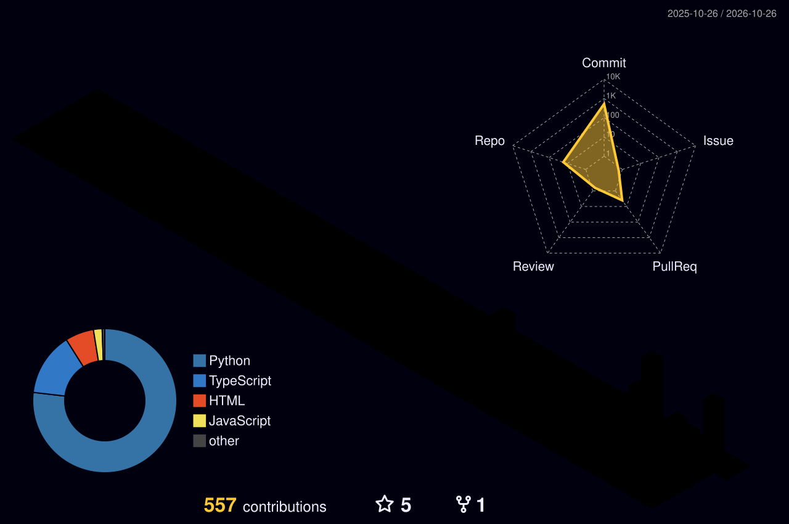

<picture>
  <source media="(prefers-color-scheme: dark)" srcset="./assets/header-dark.svg">
  
</picture>

  
  
  
  
  

  

 

<picture>
  <source media="(prefers-color-scheme: dark)" srcset="./assets/stats-dark.svg">
  
</picture>

## 👋 About

I'm a final-year **B.Tech CSE (AI & ML)** student at **SRM, Chennai**, from Kannur, Kerala, graduating in **2027**.

I make LLMs less wrong, and I prove it with tests. Sounding confident isn't enough when real money or real users depend on the answer, so I build the unglamorous parts properly: **held-out evals, adversarial test suites, deterministic fallbacks, and interfaces that show *why***.

Off the clock: **archery 🏹**, hackathons, and a **4:44 am** start.

## 💼 Experience

| | Role | Where | When | What changed |
|:-:|---|---|---|---|
| 🧪 | **Generative AI Researcher** | The Spotted App · BeSuperhuman.ai *(remote)* | Dec 2025 – Feb 2026 | Built the test suite every release had to pass. **Wrong answers dropped 35%.** |
| 🎬 | **Prompt Engineering & Automation Intern** | BabyBillion · 1.5B+ monthly views *(Bengaluru)* | May – Sep 2025 | AI video pipelines + Python automation. **One short hit 20M views; 40% less busywork.** |
| 👩‍💻 | **Technical Lead, AI/ML** | ACM-W SRMIST · 120+ members | Jan 2023 – now | Lead the tech side of the women-in-computing chapter; teach DSA and debugging. |

## 🚀 Featured work

<table>
<tr>
<td width="50%" valign="top">

An AI agent that **decides chargeback disputes** and cites the exact evidence behind every call. Every risk check is plain code, so each decision can be audited.

✅ 0 false positives · 0 false negatives on a **sealed held-out set** 
🛡️ **100%** defence across 34 prompt-injection fixtures 
📏 Known gaps published with numbers, not hidden

`Python` · `LLM agents` · `evaluation` · ⭐ 5 
<a href="https://github.com/airasalish/warrant---Razorpay-2026"><b>Code →</b></a>
</td>
<td width="50%" valign="top">

A **track record for every finfluencer stock tip.** It finds each tip in the creator's own words (Hindi, Hinglish or English), pins it to the exact second, and scores it against the Nifty 50.

🔎 6 SerpApi engines, each picked for one job 
🚨 Pump-and-dump detector validated on a **real SEBI case** 
📉 Covers BSE-only small caps that Yahoo doesn't have

`TypeScript` · `Python` · `Next.js` 
<a href="https://receipts-india.vercel.app/receipts"><b>Live demo ↗</b></a> · <a href="https://github.com/airasalish/receipts"><b>Code →</b></a>
</td>
</tr>
<tr>
<td width="50%" valign="top">

Investors don't need more charts. They need to know **what changed**. Drift flags it with five transparent rules that each show their evidence, plus an optional AI summary.

🧪 121 tests · 191 commits · deployed and in use 
🎥 <a href="https://youtu.be/CCS5dqicIbY">Walkthrough</a> · <a href="https://youtu.be/l2lPWKitNJ0">Technical deep-dive</a>

`Python` · `PostgreSQL` · `React` 
<a href="https://frontend-dusky-omega-11.vercel.app"><b>Live demo ↗</b></a> · <a href="https://github.com/airasalish/drift"><b>Code →</b></a>
</td>
<td width="50%" valign="top">

Upload a **Shapefile, KML or KMZ** and get back every feature with its area, perimeter or length in metres.

🌍 Each feature gets its own equal-area or equidistant projection 
🎯 Matches geodesic ground truth to **~1 part in 10⁹** 
⚡ About 10⁶× more accurate than the usual "pick a UTM zone" approach

`FastAPI` · `shapely` · `pyproj` · `Docker` · `CI` 
<a href="https://traverse-survey.onrender.com"><b>Live demo ↗</b></a> · <a href="https://github.com/airasalish/geospatial-measurement-api"><b>Code →</b></a>
</td>
</tr>
<tr>
<td width="50%" valign="top">

Type a goal like *"win back customers who stopped ordering."* AIRA picks the audience, writes three message variants, chooses WhatsApp or email, and **tracks delivery live**, all in under 30 seconds.

🐞 35 bugs found, fixed and logged in the app

`Next.js` · `Llama 3.3 on Groq` · `Node` 
<a href="https://aira-ai-reach-agent.vercel.app"><b>Live demo ↗</b></a> · <a href="https://github.com/airasalish/AIRA-AI-Reach-Agent"><b>Code →</b></a>
</td>
<td width="50%" valign="top">

A money agent that rebuilds a user's cash position, **forecasts 90 days ahead**, and ranks safe payment plans. It **fails closed** instead of inventing a number.

🏆 Top 2.7% at HackerRank Orchestrate, September 2026

`Python` · `Groq` · `forecasting` 
<a href="https://github.com/airasalish/buy-or-wait-orchestrate"><b>Code →</b></a>
</td>
</tr>
</table>

<b>📂 More builds</b>

 

| Project | What it is | Stack |
|---|---|---|
| [Log-Seismo](https://github.com/gershomrichardbruno/Log-Seismo) | Learns a service's normal error rate and raises graded alerts through AWS the moment it drifts. Team of five; I owned the integration. | FastAPI · React · CloudWatch · SNS |
| [Damage-claim checker](https://github.com/airasalish/-hackerrank-orchestrate-june26) | Do the photos actually prove the damage? Multimodal claim verification for cars, laptops and parcels. *HackerRank Orchestrate June: top 11.6%* | Python · vision LLMs |
| [WhatsApp notification router](https://github.com/airasalish/hackerrank_orchestrate_august26) | Ping now, save for later, or mute? Triage across text, posters and voice notes. ***HackerRank Orchestrate August: #27 of 1,983*** | Python · multimodal LLMs |
| [MovieMind](https://github.com/airasalish/Movie-Recommendation) | Content-based movie recommender with a TMDB-backed UI. | Flask · scikit-learn · React |
| [Daily Ritual](https://daily-ritual-livid.vercel.app) | The planner I built for my 4:44 am mornings. | Web |
| [aira-channel-service](https://github.com/airasalish/aira-channel-service) | Delivery simulator that fires per-customer webhooks for AIRA. | Node · Express |
| [Portfolio](https://github.com/airasalish/portfolio) · [Design portfolio](https://github.com/airasalish/portfolio-design) | My two portfolio sites, both plain HTML/CSS/JS and auto-deployed. | HTML · CSS · JS |

## 🏆 Hackathons & recognition

<picture>
  <source media="(prefers-color-scheme: dark)" srcset="./assets/orchestrate-dark.svg">
  
</picture>

<table>
<tr>
<td valign="top" width="50%">

**2026 builds**
- 🟦 **Razorpay AI Buildathon**: Warrant
- 🟨 **SerpApi India Hackathon**: Receipts
- 🟩 **Code, by Groww**: Drift
- 🟧 **Amazon ML Challenge**: entity resolution
- 🟪 **Xeno internship challenge**: AIRA
- ⬛ **HackerRank Orchestrate** ×3, which led to an invite to **HackerRank Earn**, its invite-only expert network

</td>
<td valign="top" width="50%">

**Certifications & awards**
- ☁️ **AWS Certified AI Practitioner** · 2026
- 🧩 **SAP Certified Back-End Developer, ABAP Cloud** · 2026 · [verify](https://www.credly.com/badges/5ac8fff1-58ba-4f33-850e-f3fe3a7831a2)
- 🎩 **Red Hat RH294**, Linux automation · [verify](https://www.credly.com/badges/b6c45fd1-ceac-4b50-8b31-f790a4ef6ed2)
- 🏦 **Citi Bridge 2026**: top 5% of 1,200+
- 🌱 **GirlScript Summer of Code** contributor · 2025 & 2026
- 🥇 **OpenAI × NxtWave**: state finalist

</td>
</tr>
</table>

## 🧰 Toolkit

    
  

  
  
  
  
  
  
  

## 📊 On GitHub

  

  

<picture>
  <source media="(prefers-color-scheme: dark)" srcset="https://raw.githubusercontent.com/airasalish/airasalish/output/snake-dark.svg">
  
</picture>

---

  <b>Building something where the AI has to be <i>right</i>, not just fluent?</b> 
  <a href="mailto:airasalish@gmail.com">airasalish@gmail.com</a> · <a href="https://linkedin.com/in/airasalish">LinkedIn</a> · <a href="https://aira-salish.vercel.app">aira-salish.vercel.app</a>  
  

